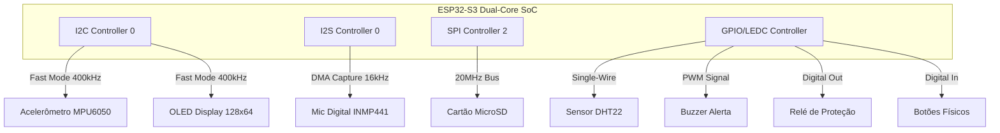
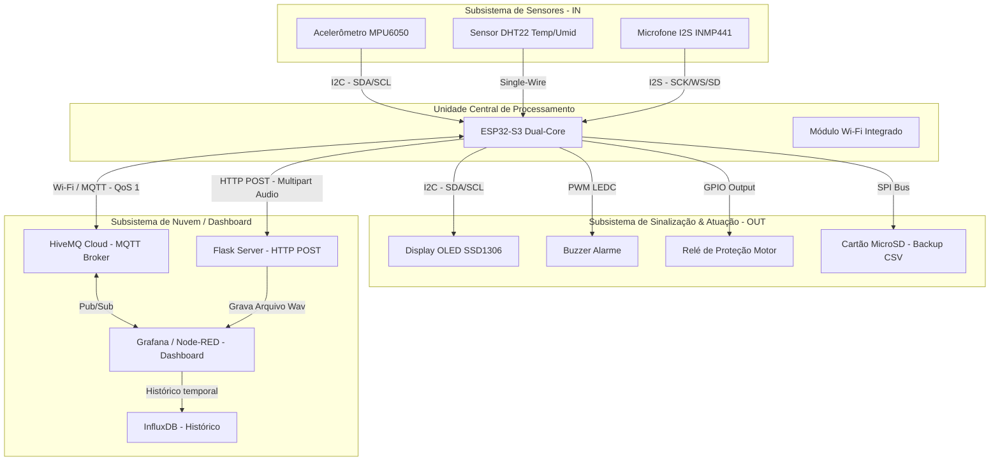

# Relatório de Arquitetura e Viabilidade Técnica
## Dispositivo IoT para Monitoramento Preditivo e Proteção de Motores AC (Residência EmbarcaTech)

Este documento estabelece as especificações técnicas, escolhas de hardware, pinagem, diagramas de blocos, arquitetura de software, protocolo de comunicação e o inovador sistema de auditoria descentralizada baseado em blockchain para o monitoramento preditivo e segurança automatizada de motores elétricos AC, utilizando a plataforma **KIIRA (ESP32-S3 Dual-Core)**.

---

## 1. Mapeamento de Hardware e Componentes (Requisito 4.1)

Para atender de forma industrial, robusta e comercialmente viável aos requisitos de chão de fábrica, foi selecionado um conjunto de componentes com alta tolerância a ruído eletromagnético e características específicas de amostragem.

### 1.1. Identificação dos Componentes

| Periférico | Modelo Selecionado | Interface | Justificativa Técnica |
|---|---|---|---|
| **Processador IoT** | **ESP32-S3 (KIIRA)** | - | Dual-Core Xtensa LX7 (240 MHz) com aceleração vetorial para IA (útil para processamento local de FFT de áudio). Possui Wi-Fi, Bluetooth 5 (LE) e coprocessador ULP. |
| **Acelerômetro** | **MPU6050** | I2C | Sensor de 6 eixos. Faixa programável de ±2g até ±16g. Excelente estabilidade térmica, ideal para detectar desalinhamento mecânico, desgaste de rolamentos e cavitação (vibrações fundamentais entre 10 Hz e 1000 Hz). |
| **Sensor de Temperatura/Umidade** | **DHT22 (AM2302)** | Single-Wire | Sensor digital de temperatura operacional (-40°C a 80°C, precisão de ±0.5°C) e umidade. Mede o aquecimento excessivo na carcaça do motor decorrente de sobrecargas. |
| **Microfone Digital** | **INMP441** | I2S | Microfone digital de alta performance de 24 bits. A interface I2S elimina completamente o ruído analógico induzido pelo acoplamento magnético dos cabos de potência do motor AC, gerando gravações limpas com SNR de 61 dBA. |
| **Display Local** | **SSD1306 (OLED 0.96")** | I2C | Display monocromático de 128x64 pixels. Permite leitura clara sob iluminação industrial direta e possui baixíssimo consumo de energia. |
| **Atuador de Proteção** | **Módulo Relé Optoacoplado** | GPIO Digital | Chaveamento isolado eletricamente para o contator/bobina de comando do motor AC. O optoacoplador isola os pinos lógicos do ESP32-S3 contra picos e transientes de chaveamento AC pesado. |
| **Alarme Sonoro** | **Buzzer Ativo** | GPIO Digital / PWM | Emissão de bipes intermitentes de alta intensidade acústica em caso de superaquecimento ou vibração de colapso, servindo de sinalizador imediato local. |
| **Armazenamento de Backup** | **Módulo Cartão MicroSD** | SPI | Gravação local em formato CSV de todo o histórico de telemetria contra quedas de sinal Wi-Fi. |
| **Botões de Controle** | **Botões Físicos Tactil** | GPIO (Pull-up) | Interface física local: **Botão de Reset** (reinicia a trava do relé e rearma o motor após resfriamento) e **Botão Silenciar** (desativa temporariamente o alarme acústico). |

---

### 1.2. Pinout (Tabela de GPIOs)

Para garantir que a inicialização ocorra sem comportamentos indesejados, foram evitados os pinos de strapping padrão do ESP32-S3 (`GPIO 0`, `GPIO 3`, `GPIO 45`, `GPIO 46` durante o boot devem ser tratados com cautela).

> [!WARNING]
> Os pinos `GPIO 45` e `GPIO 46` são pinos de boot strap no ESP32-S3 (controlam a tensão do flash VDD_SPI e o timing de inicialização). Para evitar instabilidades no boot, redefinimos os botões lógicos para pinos totalmente neutros e seguros: `GPIO 4` e `GPIO 5`.
> O relé foi associado a um pino seguro que inicia em nível lógico baixo (`GPIO 47`) para garantir que o motor não desarme ou mude de estado de forma aleatória no momento da inicialização do ESP32-S3.

Mapeamento físico de portas para a placa **KIIRA (ESP32-S3)**:

| Periférico / Barramento | Sinal do Periférico | GPIO (ESP32-S3) | Tipo de Sinal | Configuração / Observação |
|---|---|---|---|---|
| **I2C0 (Compartilhado)** | SDA (MPU6050 & OLED) | **GPIO 14** | Digital I/O | Pull-up externo de 4.7 kΩ necessário. |
| **I2C0 (Compartilhado)** | SCL (MPU6050 & OLED) | **GPIO 21** | Digital I/O | Pull-up externo de 4.7 kΩ necessário. |
| **I2S0 (Entrada de Áudio)**| SCK (BCLK) | **GPIO 2** | Digital Out | Relógio de bits da captura I2S. |
| | WS (LRCLK) | **GPIO 37** | Digital Out | Seleção de canal (Word Select). |
| | SD (Serial Data) | **GPIO 35** | Digital In | Linha de dados do microfone INMP441. |
| **DHT22 Sensor** | Data | **GPIO 36** | Digital I/O | Barramento Single-Wire com pull-up de 10 kΩ. |
| **Módulo Relé** | Control | **GPIO 47** | Digital Out | Comando de disparo (Saída). Ativa contator. |
| **Buzzer** | PWM Driver | **GPIO 3** | Digital Out | Modulação via LEDC (PWM) para tom sonoro. |
| **Cartão MicroSD (SPI)** | CS (Chip Select) | **GPIO 38** | Digital Out | Seleção de escravo SPI. |
| | SCK (Clock) | **GPIO 40** | Digital Out | Relógio SPI. |
| | MOSI (Data In) | **GPIO 39** | Digital Out | Saída de dados do master para o SD. |
| | MISO (Data Out) | **GPIO 41** | Digital In | Entrada de dados do SD para o master. |
| **Botão Reset Proteção** | Switch | **GPIO 4** | Digital In | Entrada com pull-up interno e debounce via software. |
| **Botão Silenciar Buzzer** | Switch | **GPIO 5** | Digital In | Entrada com pull-up interno e debounce via software. |

---

### 1.3. Barramentos Internos

O microcontrolador ESP32-S3 possui barramentos de hardware dedicados que operam em paralelo para evitar gargalos de amostragem:



---

## 2. Diagrama de Blocos do Sistema (Requisito 4.2)

O diagrama abaixo representa a interconexão completa de todos os subsistemas físicos e lógicos, demonstrando de forma clara o fluxo de sinais e dados.



---

## 3. Arquitetura de Software e Multiprocessamento (FreeRTOS)

O ESP32-S3 possui dois núcleos físicos (Core 0 e Core 1). A fim de garantir que as rotinas de tempo crítico (segurança do motor) nunca sejam bloqueadas pelas operações de latência imprevisível (como conexão de rede Wi-Fi e chamadas de API do MQTT), o processamento do firmware será dividido estrategicamente entre os núcleos.

### 3.1. Divisão de Tarefas (FreeRTOS Task Mapping)

```text
[ CORE 0 ]  ──►  task_sensors       (Leitura MPU6050 + DHT22)
                 task_protection    (Lógica do Relé e Segurança - Alta Prioridade)
                 task_telemetry     (Cliente MQTT + Escrita no Cartão SD)

[ CORE 1 ]  ──►  task_display       (Atualização UI Local - OLED)
                 task_buzzer        (Gerador de Frequências e Alarmes)
                 task_audio_record  (Aquisição de Áudio I2S + Envio HTTP POST)
```

---

## 4. Especificação do Protocolo de Comunicação e IoT (Requisito 4.3)

O dispositivo adotará uma **arquitetura híbrida de conectividade**. Dados de telemetria contínuos e comandos leves serão trafegados via **MQTT (Message Queuing Telemetry Transport)** sob o protocolo TCP/IP, aproveitando sua característica assíncrona, leveza e suporte bidirecional instantâneo. Arquivos pesados (como o áudio de 5 segundos de gravação) serão trafegados via **HTTP POST**.

### 4.1. Árvore de Tópicos MQTT (Hierarquia Industrial)

Para suportar múltiplos motores de forma escalável na fábrica, a seguinte árvore de tópicos será implementada no Broker (HiveMQ Cloud):

| Tópico | Sentido | Retained? | Função |
|---|---|---|---|
| `motor/{id}/telemetry` | Dispositivo ➔ Nuvem | Não | Transmissão periódica das leituras de vibração, temperatura e umidade. |
| `motor/{id}/status` | Dispositivo ➔ Nuvem | **Sim (True)** | Status de conexão e transições de estados críticos (boot, alertas, desligamento). O uso de mensagem retida garante que a Dashboard saiba o estado real do motor assim que ela é aberta. |
| `motor/{id}/cmd` | Nuvem ➔ Dispositivo | Não | Envio de comandos assíncronos a partir da Dashboard (Rearme, desligamento manual, gravação de áudio). |
| `motor/{id}/cmd/response` | Dispositivo ➔ Nuvem | Não | Confirmação de recebimento e status de execução de cada comando recebido (*handshake*). |
| `motor/{id}/thresholds` | Nuvem ➔ Dispositivo | **Sim (True)** | Configuração remota dos limiares de temperatura e vibração sem necessidade de recompilação do firmware. |

---

### 4.2. Estrutura de Dados (Payloads JSON)

Abaixo estão definidos os contratos de dados em formato JSON.

#### A) Telemetria de Sensores (`motor/{id}/telemetry`)
Enviado periodicamente (ex: a cada 5 segundos).
```json
{
  "timestamp": 1779361642,
  "sensors": {
    "temp_c": 58.4,
    "humidity_pct": 45.2,
    "vibration": {
      "rms_x_g": 0.42,
      "rms_y_g": 0.35,
      "rms_z_g": 0.78,
      "resultant_rms_g": 0.95,
      "peak_g": 1.45
    }
  },
  "diagnostics": {
    "wifi_rssi_dbm": -65,
    "free_heap_bytes": 184520,
    "uptime_s": 3600
  }
}
```

#### B) Status de Conexão e LWT (`motor/{id}/status`)
Utiliza o recurso **LWT (Last Will and Testament)** do MQTT. Se a conexão cair abruptamente, o broker publica automaticamente a mensagem `"OFFLINE"`.
```json
{
  "connection": "ONLINE",
  "motor_state": "ARMED",
  "relay_closed": true,
  "firmware_version": "1.0.2",
  "ip_address": "192.168.1.150"
}
```

#### C) Mensagem de Alerta Crítico Instantâneo (`motor/{id}/status`)
Publicado no momento exato em que a `task_protection` detecta uma anomalia de colapso e desarma o motor.
```json
{
  "alert": {
    "type": "CRITICAL_SHUTDOWN", 
    "cause": "VIBRATION_LIMIT_EXCEEDED",
    "measured_value": 3.42,
    "threshold_limit": 3.00,
    "cooldown_s": 60
  }
}
```

#### D) Comandos Recebidos da Dashboard (`motor/{id}/cmd`)
Cada comando possui um identificador exclusivo (`command_id`) para garantir a rastreabilidade (handshake).
```json
{
  "command_id": "9b1deb4d-3b7d-4bad-9bdd-2b0d7b3dcb6d",
  "action": "TRIGGER_AUDIO_RECORD",
  "params": {
    "duration_s": 5
  }
}
```

#### E) Confirmação de Comando (`motor/{id}/cmd/response`)
```json
{
  "command_id": "9b1deb4d-3b7d-4bad-9bdd-2b0d7b3dcb6d",
  "status": "SUCCESS",
  "error_message": ""
}
```

#### F) Ajuste Remoto de Limiares (`motor/{id}/thresholds`)
```json
{
  "thresholds": {
    "temp_alert_c": 70.0,
    "temp_critical_c": 80.0,
    "vib_alert_g": 1.2,
    "vib_critical_g": 2.8
  }
}
```

---

### 4.3. Protocolo de Transmissão de Áudio (HTTP POST)

Após receber o comando `TRIGGER_AUDIO_RECORD`, o ESP32-S3 faz a gravação via I2S e envia o arquivo binário para o servidor central através de uma requisição HTTP POST.

* **Endpoint do Servidor:** `http://[IP_DO_SERVIDOR]/api/audio/upload`
* **Método:** `POST`
* **Content-Type:** `multipart/form-data`
* **Campos da Requisição:**
  * `device_id` (texto): `"motor_ac_compressor_01"`
  * `timestamp` (número): `1779361655`
  * `duration` (número): `5`
  * `audio` (binário): O arquivo de áudio com cabeçalho RIFF WAV (16 kHz, 16 bits, Mono).

---

## 5. Algoritmos de Processamento Local (Vibração RMS)

Como recomendado para evitar saturação da rede de fábrica, o ESP32-S3 não transmitirá dados analógicos brutos do acelerômetro, mas sim o **cálculo local da vibração RMS** e o **valor de pico de deslocamento** a cada ciclo de medição.

### 5.1. Formulação Matemática da Raiz Quadrada Média (RMS)
A aceleração RMS reflete a energia total da vibração do motor mecânico, sendo calculada localmente no firmware em intervalos regulares (janelas de medição de $N = 256$ a $1024$ amostras a $500\text{ Hz}$).
Para cada eixo ($x, y, z$), o valor RMS de aceleração ($a_{\text{RMS}}$) é obtido pela fórmula:

$$a_{\text{RMS}} = \sqrt{\frac{1}{N} \sum_{i=1}^{N} (a_i - \bar{a})^2}$$

Onde:
* $N$ é o número de amostras contidas na janela de cálculo.
* $a_i$ é a aceleração instantânea na amostra $i$ medida em $g$ (multiplicada pela escala de sensibilidade do MPU6050).
* $\bar{a}$ é a média aritmética das amostras da janela (usada para remover o *offset* estático do sensor devido à gravidade):

$$\bar{a} = \frac{1}{N} \sum_{i=1}^{N} a_i$$

### 5.2. Cálculo do RMS Tridimensional Composto
O indicador global de vibração composto do motor AC ($A_{\text{comp}}$) que será utilizado para validar os limites de disparo da proteção do relé é calculado pela resultante vetorial dos três eixos RMS:

$$A_{\text{comp}} = \sqrt{a_{x,\text{RMS}}^2 + a_{y,\text{RMS}}^2 + a_{z,\text{RMS}}^2}$$

Se $A_{\text{comp}} \ge 3.0\text{ g}$ ou $\text{Temperatura} \ge 85^\circ\text{C}$, a tarefa de proteção física emite o comando imediato de abertura do relé (desligamento do motor) e muda o estado global do dispositivo para `PROTECTED`.

---

## 6. Viabilidade Mecânica e Gabinete 3D

Para que o monitoramento preditivo apresente alta confiabilidade, o projeto mecânico do invólucro do dispositivo deve respeitar as seguintes premissas industriais de campo:

### 6.1. Acoplamento de Vibração Sem Amortecimento
O acelerômetro MPU6050 deve ser **parafusado diretamente em suportes rígidos integrados à base** do gabinete. A caixa plástica externa do gabinete deve ser fixada de forma rígida ao motor elétrico AC através de:
* **Ímãs industriais de neodímio de alta potência** rosqueados na base do invólucro para fixação na carcaça de ferro fundido do motor; ou
* **Abas de fixação sólidas** integradas para abraçadeiras metálicas ou parafusos mecânicos diretos nos olhais de içamento do motor.

### 6.2. Isolamento Térmico Interno e Captura Externa
* O sensor de temperatura do motor deve estar em **contato térmico físico** com o ponto de acoplamento da base do motor usando um bloco metálico ou pastilha condutora (térmica) isolada do calor gerado internamente pelo ESP32-S3 e pelo módulo de relé.
* Aberturas superiores e inferiores protegidas com telas ou filtros contra poeira industrial permitirão a dissipação do calor do ESP32-S3 por convecção natural.

### 6.3. Guia de Ondas Acústicas do Microfone Digital
Para permitir que o som da mecânica interna do motor atinja o microfone digital INMP441 sem abafamento ou ressonâncias parasitas originadas dentro do case do dispositivo, será projetado um **mini-duto de captação direcionada**. Este duto ligará a face frontal de captação do microfone diretamente a uma pequena perfuração cônica externa de $2\text{ mm}$ no invólucro, protegida por uma membrana hidrofóbica à prova de poeira (IP65 acústico).

---

## 7. Arquitetura de Transparência e Auditoria via Blockchain

Em ambientes fabris de missão crítica, paradas não programadas geram disputas contratuais complexas. Para garantir a transparência absoluta, auditoria externa contra fraudes e validação de apólices de seguro, o sistema integra o registro imutável de eventos críticos de segurança em uma **Blockchain** por meio de **Smart Contracts**.

```
┌──────────┐  (Alerta MQTT)   ┌──────────────┐ (Transação Web3) ┌────────────────────┐
│ ESP32-S3 ├─────────────────►│   Node-RED   ├─────────────────►│   Smart Contract   │
└──────────┘                  │  Gateway API │                  │ (Blockchain Ledger)│
                              └──────────────┘                  └────────────────────┘
```

### 7.1. Fluxo de Registro Imutável
A telemetria comum a cada 5 segundos é armazenada localmente (InfluxDB) para fins de performance, enquanto apenas as **Transições de Estado Críticas e Mudanças de Parâmetros** são registradas na rede blockchain. 

O Node-RED assina o tópico de telemetria e o status do motor. Em caso de evento crítico, ele empacota os dados da transação, assina com a chave privada autorizada da fábrica e chama a função `logEvent` do contrato na rede blockchain (ex: rede privada Hyperledger ou camada L2 como Polygon/Arbitrum para taxas de centavos).

### 7.2. Contrato Inteligente de Auditoria (Solidity v0.8.20)

```solidity
// SPDX-License-Identifier: MIT
pragma solidity ^0.8.20;

contract MotorAuditLedger {
    
    address public owner;
    
    // Estrutura de dados para o registro de auditoria imutável
    struct AuditLog {
        uint256 timestamp;
        string eventType;      // BOOT, SHUTDOWN, OVERRIDE, THRESHOLD_CHANGE
        string description;    // Detalhes legíveis (ex: "Vibração 3.42g > Limite 3.00g")
        address operator;      // Carteira de quem gerou a ação (dashboard, gateway ou dispositivo)
        bytes32 firmwareHash;  // Hash do firmware ativo do ESP32 para auditar adulterações
    }
    
    // Mapeamento: ID do Motor => Histórico de Logs de Auditoria
    mapping(string => AuditLog[]) private motorLogs;
    
    // Evento para monitoramento em tempo real fora da rede
    event NewAuditLog(
        string indexed deviceId, 
        string eventType, 
        string description, 
        address indexed operator
    );

    modifier onlyOwner() {
        require(msg.sender == owner, "Acesso negado: Apenas a conta administradora pode registrar.");
        _;
    }

    constructor() {
        owner = msg.sender;
    }

    // Registra um novo evento crítico na blockchain
    function logEvent(
        string memory _deviceId,
        string memory _eventType,
        string memory _description,
        bytes32 _firmwareHash
    ) public onlyOwner {
        
        AuditLog memory newLog = AuditLog({
            timestamp: block.timestamp,
            eventType: _eventType,
            description: _description,
            operator: tx.origin,
            firmwareHash: _firmwareHash
        });
        
        motorLogs[_deviceId].push(newLog);
        
        emit NewAuditLog(_deviceId, _eventType, _description, tx.origin);
    }

    // Retorna todos os logs de auditoria de um motor para exibição no Grafana/Dashboard
    function getMotorLogs(string memory _deviceId) public view returns (AuditLog[] memory) {
        return motorLogs[_deviceId];
    }
    
    // Retorna a contagem de registros de um motor específico
    function getLogsCount(string memory _deviceId) public view returns (uint256) {
        return motorLogs[_deviceId].length;
    }
}
```

---

Este documento serve como a base de engenharia conceitual e prática que garantirá a estabilidade, imunidade a ruídos industriais, conectividade transparente e auditoria imutável do dispositivo IoT durante o desenvolvimento.
