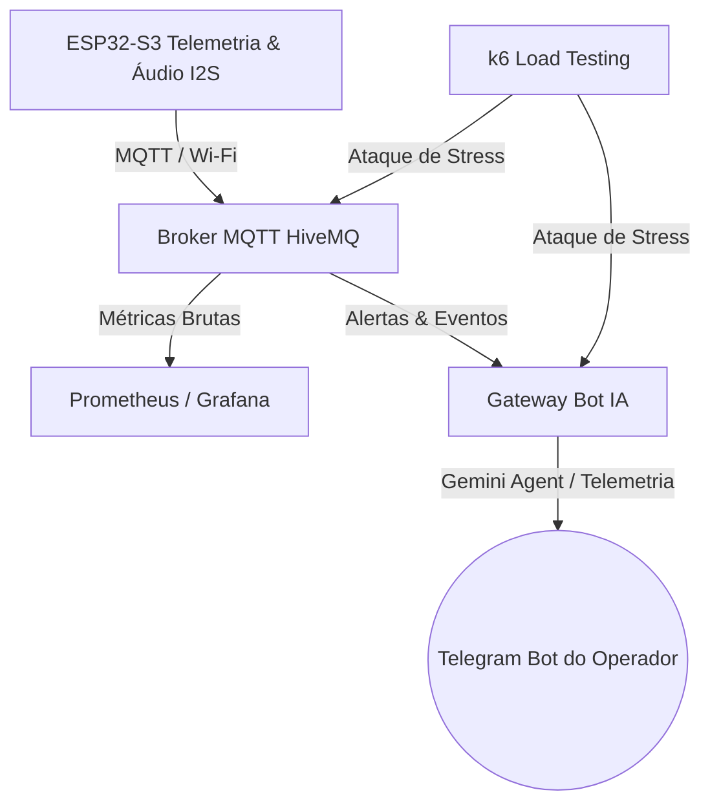

# 🚀 Implementações e Planos Futuros - Projeto Kiira

Este documento serve como mapa de bordo e arquitetura de referência para o sistema de monitoramento preditivo e proteção preventiva de motores síncronos e compressores industriais AC.

---

## 💎 1. O Que Já Está Implementado (Branch `teste/arquitetura-e-firmware`)

### 🌐 A. Dashboard Industrial Web (Glassmorphism UI)
* **Status:** 100% Pronto e Publicado Online.
* **Hospedagem:** Cloud Global em [https://f9d55a06848b4fcc8b.v2.appdeploy.ai/](https://f9d55a06848b4fcc8b.v2.appdeploy.ai/).
* **Conectividade:** Integração instantânea com Broker MQTT público (`broker.hivemq.com` na porta `8884` com SSL/TLS ativo em WebSockets).
* **Simulador Local Embutido:** Permite validações dinâmicas de estados e gráficos diretamente no navegador sem a necessidade de hardware conectado.
* **Blockchain Ledger:** Auditoria visual de logs imutáveis com geração de hashes simulados e registro persistente em tabela.

### 🔌 B. Injeção de Falhas Remota e Local (Teste de Estresse)
* **No Firmware (C):** Parser MQTT da ação `"INJECT_ANOMALY"`. Quando acionado, eleva progressivamente a vibração resultante em +0.25g e a temperatura em +1.0°C a cada 500ms na tarefa de sensores FreeRTOS.
* **Segurança Automática:** Assim que o motor atinge o limite e desarma em `task_protection`, a flag de injeção é limpa (`bInjectAnomaly = false`), permitindo o religamento normal do motor após o rearme do operador.
* **No Dashboard:** Botão físico "Injetar Anomalia" posicionado na barra de controle lateral, habilitado apenas quando o motor está em atividade normal (`ARMED` ou `ALERT`).

### 🎙️ C. Processador Acústico I2S Real de Alta Fidelidade
* **No Firmware (C):** Task de alta velocidade rodando no **Core 1** dedicada à captura direta de áudio via DMA (Direct Memory Access) a partir do barramento I2S.
* **Cálculo de Energia Acústica (dB SPL):** Processamento matemático das amostras de 16-bits para calcular a amplitude RMS real e conversão logarítmica de volume acústico (dB).
* **Fallback Harmônico (Simulação de Estresse):** Caso o microfone físico não esteja plugado ou na simulação do Wokwi, o firmware gera uma assinatura mecânica simulada combinando a frequência senoidal elétrica fundamental de 60Hz + harmônicos de rotação em 180Hz + ruído branco, garantindo a perfeita execução do código.

### 💾 D. Suporte a Cartão SD (Virtual File System FAT)
* **No Firmware (C):** Inicialização física e montagem automática de partições FAT em Cartões SD através do protocolo SPI utilizando os pinos GPIO mapeados (`PIN_SD_MOSI` 39, `PIN_SD_MISO` 41, `PIN_SD_SCK` 40, `PIN_SD_CS` 38).
* **Robustez de Armazenamento:** Preparado para gravação local offline de arquivos `.csv` de telemetria e arquivos de áudio `.wav` para auditoria física independente de conexões de internet.

---

## ⚡ 2. Planos Futuros & Roadmap de Evolução

### 🤖 Fase A: Agente de IA Preditivo (Telegram Bot + Gemini API)
* **Objetivo:** Adicionar uma camada de conversação inteligente para os operadores da fábrica.
* **Arquitetura:**
  1. Um serviço intermediário leve em Python rodando em background (na nuvem ou servidor local) atua como gateway conectando o Broker MQTT ao Telegram.
  2. Integrar a API do **Gemini** (através do SDK oficial da Google) a esse serviço.
  3. **Comando de Linguagem Natural:** O operador envia uma mensagem de texto para o bot no celular: *"Como está a saúde da máquina 1?"*
  4. O Agente de IA recupera o histórico recente de vibração e o nível de ruído em dB SPL gerado pelo processamento acústico I2S e responde de forma rica: *"A máquina 1 está estável. A temperatura está em 52°C e a vibração em 0.8g. No entanto, notei um leve aumento de 4dB na frequência harmônica de 180Hz nas últimas 2 horas. Recomendo agendar uma lubrificação preventiva nos rolamentos nas próximas 48 horas."*

### 🧪 Fase B: Testes de Carga Automatizados com k6
* **Objetivo:** Garantir que o sistema seja robusto o suficiente para rodar em larga escala em uma indústria com dezenas ou centenas de compressores ativos.
* **Implementação:**
  1. Criação de scripts em Javascript para o **k6** simulando centenas de conexões simultâneas de placas ESP32-S3 ativas.
  2. Disparar rajadas de telemetria MQTT e uploads em massa de arquivos de áudio WAV de 160 KB para estressar a infraestrutura de rede, o Broker MQTT e os servidores de banco de dados.
  3. Mensurar gargalos de latência, concorrência e perdas de pacote para certificar a resiliência do sistema antes da implantação comercial.

### 📊 Fase C: Observabilidade Avançada (Prometheus & Grafana)
* **Objetivo:** Criar cockpits operacionais corporativos para as salas de engenharia e automação.
* **Implementação:**
  1. **Scraping de Métricas (Prometheus):** Integração de um exporter MQTT para Prometheus (`mqtt2prometheus`). O Prometheus coleta a vibração RMS, pico, temperatura e desarmes a cada ciclo, armazenando-os como série temporal de altíssimo desempenho.
  2. **Visualização Executiva (Grafana):** Montagem de painéis industriais dinâmicos no Grafana, plotando gráficos térmicos tridimensionais das carcaças, derivadas de vibração e relatórios de disponibilidade de máquina (OEE).
  3. **Alertas Inteligentes:** Configuração de limites e envio automático de requisições de manutenção preditiva (ordens de serviço) de forma 100% automatizada.
